# 英検準2級 学習アプリ 画面一覧

- 版: 0.1（ドラフト）
- 作成日: 2026-10-17
- 関連: [要件定義書](requirements.md)

## 1. 画面一覧

### 共通

| ID | 画面名 | 概要 |
|---|---|---|
| C-01 | ログイン | ログインIDとパスワードを入力する |
| C-02 | 初回パスワード変更 | 仮パスワードでのログイン後に、自分のパスワードを設定する |

### 生徒

| ID | 画面名 | 概要 |
|---|---|---|
| S-01 | ホーム | 今日の学習、課題、連続学習日数、周回の進度、受験日までの残り日数 |
| S-02 | 問題 | 4択の問題を1問ずつ解く。長文は本文と設問をタブで切り替える |
| S-03 | 解答結果（S-02 内） | 正誤、正答、日本語の解説。「問題がおかしい」の報告ボタン |
| S-04 | セット結果 | セットの正答数、間違えた問題の一覧、次のセットへのボタン |
| S-05 | 日・周回の完了 | その日の分の完了表示。30日目は周回の振り返り（形式別の正答率と前の周との比較） |
| S-06 | 自由演習 | 形式と問題数を選んで始める |
| S-07 | 学習記録 | 形式別の正答率、日別の学習量、周回ごとの成績 |
| S-08 | 問題の報告（ダイアログ） | 理由（正解が違う、正解が複数ある、日本語の解説が誤り、その他）とコメント |
| S-09 | 設定 | パスワード変更、ログアウト、ホーム画面への追加方法 |

### 講師

| ID | 画面名 | 概要 |
|---|---|---|
| T-01 | ダッシュボード | 生徒一覧（進度・遅れ・最終学習日・アラート）、確認待ちの件数、API使用額 |
| T-02 | 生徒詳細 | 形式別の正答率、日別の学習量、周回ごとの成績、苦手な問題、受験日 |
| T-03 | 生徒の追加・編集 | ログインID、ニックネーム、仮パスワード、受験日、カリキュラム開始日。仮パスワードの再発行、削除 |
| T-04 | 課題一覧 | 配った課題と、生徒ごとの完了状況・正答率 |
| T-05 | 課題の作成 | 対象の生徒、形式と問題数（または問題を直接選択）、期限 |
| T-06 | 問題一覧 | 形式別の在庫数、検索・絞り込み（形式、状態、生成元）、無効化 |
| T-07 | 問題の編集 | 本文、問題文、選択肢、正答、解説の編集。手入力での新規作成 |
| T-08 | 確認待ち | 抜き取り確認の対象と、生徒から報告された問題。承認・修正・無効化 |
| T-09 | 問題の生成 | 形式、数、テーマ、即時かバッチかを選ぶ。費用の見積もりを表示。生成ジョブの一覧と結果 |
| T-10 | 設定 | API予算、未学習アラートの日数、在庫の警告日数、講師アカウントの追加 |

講師も生徒用の画面で問題を解ける（動作確認用）。

## 2. 画面遷移

```mermaid
flowchart TD
  C01[C-01 ログイン] -->|初回| C02[C-02 初回パスワード変更]
  C01 -->|生徒| S01
  C01 -->|講師| T01
  C02 --> S01

  subgraph 生徒
    S01[S-01 ホーム] -->|今日の学習・課題| S02[S-02 問題]
    S02 <--> S03[S-03 解答結果]
    S03 --> S08[S-08 問題の報告]
    S02 -->|セット終了| S04[S-04 セット結果]
    S04 -->|次のセット| S02
    S04 -->|その日の分が完了| S05[S-05 日・周回の完了]
    S05 --> S01
    S01 --> S06[S-06 自由演習] --> S02
    S01 --> S07[S-07 学習記録]
    S01 --> S09[S-09 設定]
  end

  subgraph 講師
    T01[T-01 ダッシュボード] --> T02[T-02 生徒詳細] --> T03[T-03 生徒の追加・編集]
    T01 --> T04[T-04 課題一覧] --> T05[T-05 課題の作成]
    T01 --> T06[T-06 問題一覧] --> T07[T-07 問題の編集]
    T01 --> T08[T-08 確認待ち] --> T07
    T01 --> T09[T-09 問題の生成]
    T01 --> T10[T-10 設定]
  end
```



### ナビゲーション

- **生徒（スマホ）**: 画面下部のタブバーで「ホーム／自由演習／記録／設定」を切り替える。問題を解いている間はタブバーを隠し、「中断」ボタンだけを表示する。
- **生徒（PC）**: 同じ画面を最大幅 640px 程度で中央に表示する。
- **講師**: PCでの利用を主に想定し、上部のタブで「ダッシュボード／課題／問題／生成／設定」を切り替える。スマホでも閲覧はできる。

## 3. 主要画面のイメージ

### S-01 ホーム（スマホ）

```text
┌──────────────────────────┐
│ こんにちは、たろう さん          │
│ 🔥 連続 5日   受験まで あと 62日   │
├──────────────────────────┤
│ 📌 課題（期限 10/20）             │
│ 会話文 10問        [はじめる]     │
├──────────────────────────┤
│ 今日の学習  1周目 12日目 / 30     │
│ ■■■■□□□□□□  セット 2 / 4       │
│ ・長文空所 1題                    │
│ ・語彙 10問                      │
│ ・会話文 2問                     │
│ ・復習 6問                       │
│          [つづきから]            │
├──────────────────────────┤
│ このペースだと受験日までに          │
│ 3周目の 2日目 まで進めます          │
└──────────────────────────┘
 [ホーム] [自由演習] [記録] [設定]
```

### S-02／S-03 問題と解答結果（スマホ、語彙）

```text
┌──────────────────────────┐
│ [中断]   語彙  3 / 10              │
├──────────────────────────┤
│ Kenji was too tired to ( ) his    │
│ homework last night.              │
│                                   │
│ ┌──────────────────────┐ │
│ │ 1  finish                   │ │
│ └──────────────────────┘ │
│ ┌──────────────────────┐ │
│ │ 2  happen                   │ │
│ └──────────────────────┘ │
│ ┌──────────────────────┐ │
│ │ 3  invite                   │ │
│ └──────────────────────┘ │
│ ┌──────────────────────┐ │
│ │ 4  borrow                   │ │
│ └──────────────────────┘ │
└──────────────────────────┘
        ↓ 選択肢を押すと
┌──────────────────────────┐
│ ⭕ 正解！  正答: 1 finish          │
│ 解説: 「too ～ to …」で「～すぎて…  │
│ できない」。宿題を「終える」が自然。  │
│                                   │
│ [問題がおかしい]        [次へ ▶]   │
└──────────────────────────┘
```

### S-02 問題（スマホ、長文）

```text
┌──────────────────────────┐
│ [中断]   内容一致  1 / 3           │
│  [ 本文 ]  [ 設問 ]                │
├──────────────────────────┤
│ A New Library in Town             │
│ Last spring, the city of ...      │
│ （本文をスクロール）                │
└──────────────────────────┘
```

PCでは本文と設問を左右に並べて表示する。

### T-01 ダッシュボード（PC）

```text
┌──────────────────────────────────────────────────────────┐
│ ダッシュボード     確認待ち 4件 ／ 報告 1件   API 1,240円 / 5,000円  │
├──────────────────────────────────────────────────────────┤
│ 生徒      進度           遅れ  最終学習   連続  正答率  受験まで  │
│ ⚠ はなこ  1周目 8日目    -6日  4日前      0日   64%    55日     │
│   たろう  1周目 12日目   -2日  今日       5日   78%    62日     │
│   けん    2周目 3日目     0日  昨日      12日   85%    40日     │
├──────────────────────────────────────────────────────────┤
│ 問題の在庫（けんさんの進度を基準）                          │
│ 形式       在庫   あと何日分     足りない数  作る数の目安      │
│ ⚠ 語彙     197    14日分        142        157（6回に分けて）│
│   会話文   79     周の終わりまで足りる  1       2（1回）        │
│   長文空所  10     26日分        2          3（1回に分けて）  │
└──────────────────────────────────────────────────────────┘
```

在庫の見通しは要件 STK-04〜11。2周目以降は上限の見積りと注記する。

## 4. 決定事項（ドラフト時の未確定事項）

2026-10-17 に確定。

| No. | 内容 | 決定 |
|---|---|---|
| 1 | 生徒が問題を解いている途中でアプリを閉じたときの再開範囲 | セットの途中から再開 |
| 2 | 1日分の中でのセットの分け方 | 形式ごとに1セット（復習は最後にまとめて1セット） |
| 3 | 講師画面をスマホにどこまで最適化するか | 閲覧と確認待ちの承認だけはスマホで操作しやすくする |
